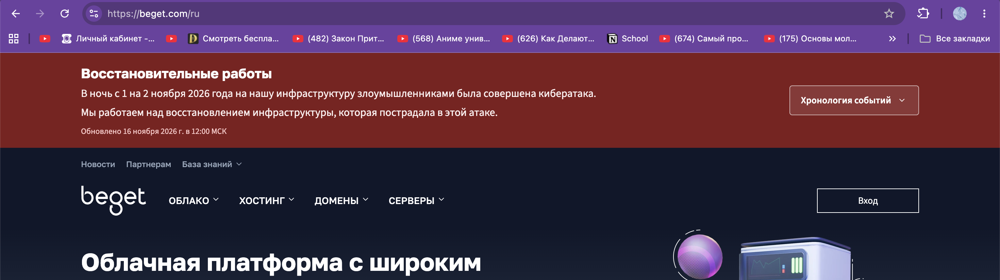

# Задание 5. Автоматическое резервное копирование и ротация логов

19 ноября 2026 года я настроил резервное копирование логов веб-приложения. Приложение получает HTTP-запрос каждую минуту и дописывает строку в `/var/log/app/app.log`. Чтобы этот файл не рос бесконечно, я написал [скрипт на Bash](backup_and_clean.sh) и настроил его ежедневный запуск в 02:00 по времени Барнаула.

## Где я выполнял работу

На своём компьютере с macOS я запустил Ubuntu 24.04 в контейнере Docker Desktop. Внутри контейнера работали Bash 5.2, cron и [небольшое PHP-приложение](hosting/public/index.php). Для логов и архивов я использовал отдельные тома Docker. Архивы хранятся локально в `/opt/backups/`.

## Как я организовал резервное копирование

1. **Проверка прав.** В начале скрипта я проверяю `$EUID` — идентификатор пользователя, от имени которого выполняется процесс. У root он равен нулю. При другом значении скрипт выводит ошибку и завершает работу. Затем он проверяет наличие нужных команд и создаёт недостающие каталоги.
2. **Блокировка записи.** Между копированием и очисткой в лог может поступить новая строка. Чтобы её сохранить, я использовал общий файл блокировки `/run/lock/app-backup.lock`. Приложение удерживает блокировку во время записи, а скрипт — во время бэкапа. Это работает, потому что обе программы используют один и тот же механизм `flock`.
3. **Создание архива.** С помощью `find` я выбираю обычные файлы с расширением `.log` непосредственно из `/var/log/app/`. Команда `tar -czf` объединяет их в один файл и сжимает его с помощью gzip. В имя архива я включил дату и время запуска.
4. **Проверка перед очисткой.** Сразу после `tar` я сохраняю значение `$?` — код завершения команды. Ноль означает успех. Затем командой `tar -tzf` проверяю, что список файлов в архиве читается, и переношу архив в `/opt/backups/`. Если любой из этих шагов завершается ошибкой, исходные записи сохраняются.
5. **Очистка логов.** Командой `truncate --no-create -s 0` я уменьшаю размер каждого скопированного файла до нуля. Файл сохраняет свой номер в файловой системе (inode), права и владельца. Благодаря этому приложение продолжает запись через уже открытый файл.
6. **Ротация и журнал.** Для архивов с именами `app_backup_*.tar.gz` я сравниваю время последнего изменения с границей хранения в семь суток. Более старые архивы удаляю. В `/var/log/backup_script.log` скрипт записывает время, результаты операций, ошибки и количество удалённых архивов. Если обычному пользователю запрещена запись в этот журнал, сообщение об отказе он получает в терминале.

## Как я проверил работу

Из папки с `compose.yaml` я запустил стенд, отправил приложению запрос и посмотрел содержимое лога. Перед запуском скрипта и сразу после него я выполнил `stat`, чтобы сравнить размер и inode файла.

```bash
docker compose -p devops-task5 up -d --build

docker compose -p devops-task5 exec -T lab curl -fsS http://127.0.0.1:8080/

docker compose -p devops-task5 exec -T lab uname -a
docker compose -p devops-task5 exec -T lab date
docker compose -p devops-task5 exec -T lab crontab -l

docker compose -p devops-task5 exec -T lab cat /var/log/app/app.log
docker compose -p devops-task5 exec -T lab stat /var/log/app/app.log

docker compose -p devops-task5 exec -T lab /usr/local/sbin/backup_and_clean.sh

docker compose -p devops-task5 exec -T lab ls -lh /opt/backups
docker compose -p devops-task5 exec -T lab stat /var/log/app/app.log
docker compose -p devops-task5 exec -T lab tail -n 15 /var/log/backup_script.log

docker compose -p devops-task5 exec -T lab curl -fsS http://127.0.0.1:8080/
docker compose -p devops-task5 exec -T lab cat /var/log/app/app.log

docker compose -p devops-task5 exec -T --user nobody lab /usr/local/sbin/backup_and_clean.sh
```

До запуска размер лога был **230 байт**, после архивации — **0 байт**. В обоих случаях inode был **170919**. Затем я повторил HTTP-запрос и увидел новую строку в том же файле. Так я проверил, что старые записи попали в архив, а приложение продолжило работу. [Вывод команд](stand-verification.txt) · [Получившийся архив](evidence/example_backup.tar.gz)

Для остановки стенда с сохранением данных я предусмотрел команду.

```bash
docker compose -p devops-task5 down
```

## Как я настроил расписание

В crontab пользователя root я установил строку ежедневного запуска.

```cron
0 2 * * * /usr/local/sbin/backup_and_clean.sh >/dev/null 2>&1
```

Первое число задаёт минуту, второе — час. Три звёздочки задают запуск в любой день месяца, в любой месяц и в любой день недели. На моём стенде используется часовой пояс `Asia/Barnaul`. Для запуска по расписанию компьютер и контейнер должны работать в назначенное время.

Для отдельного сервера Ubuntu я подготовил команды установки. Практическую проверку я проводил в контейнере.

```bash
sudo apt-get update
sudo apt-get install bash tar gzip coreutils findutils util-linux cron
sudo install -m 0750 backup_and_clean.sh /usr/local/sbin/backup_and_clean.sh
sudo /usr/local/sbin/backup_and_clean.sh
sudo systemctl enable --now cron
sudo crontab -e
```

## Результаты испытаний

Я запустил автоматические проверки в отдельном одноразовом контейнере. В нём тесты могли создавать и очищать учебные логи независимо от основного стенда.

```bash
docker build -t devops-task5-lab:local .
docker run --rm --mount type=bind,src="$PWD",dst=/work,readonly devops-task5-lab:local python3 /work/tests/run_tests.py
```

**Все 12 проверок прошли.** В частности, я проверил отказ обычному пользователю, границу хранения в семь суток, обработку имён файлов с пробелами, сохранение записей при ошибке архивации и работу приложения после очистки. Для проверки cron я временно добавил ежеминутный запуск и убедился, что архив появился без ручного вызова скрипта. Так я проверил сам запуск через планировщик, не дожидаясь 02:00. [Результаты проверок](verification.txt)

## Что получилось с Beget

Во время работы мне не удалось разместить приложение на бесплатном хостинге Beget. На сайте провайдера я увидел сообщение о восстановительных работах и сохранил скриншот. PHP-приложение я подготовил для размещения, а запись логов, архивацию и работу cron проверил на локальном Linux-стенде.



## Источники

- [Beget — официальная страница с сообщением о восстановлении](https://beget.com/ru/hosting/free).
- [flock — блокировка в shell](https://man7.org/linux/man-pages/man1/flock.1.html).
- [truncate — изменение размера без удаления](https://man7.org/linux/man-pages/man1/truncate.1.html).
- [crontab — синтаксис расписания](https://man7.org/linux/man-pages/man5/crontab.5.html).

## Полный код основного Bash скрипта

```bash
#!/bin/bash
# Linux, GNU tar/coreutils/findutils, util-linux. Запускать от root.
set -u
set -o pipefail
export PATH=/usr/sbin:/usr/bin:/sbin:/bin
umask 027

LOG_DIR=/var/log/app
BACKUP_DIR=/opt/backups
SCRIPT_LOG=/var/log/backup_script.log
LOCK_FILE=/run/lock/app-backup.lock
RETENTION_DAYS=7

# Обычному пользователю системный журнал может быть недоступен.
if (( EUID != 0 )); then
    message="[$(date '+%F %T%z')] [ERROR] Нужен root: запустите скрипт через sudo."
    printf '%s\n' "$message" >&2
    { printf '%s\n' "$message" >> "$SCRIPT_LOG"; } 2>/dev/null || :
    exit 1
fi
if [[ $(uname -s) != Linux ]]; then
    printf 'ERROR: требуется Linux.\n' >&2
    exit 1
fi

log() {
    local line
    line="[$(date '+%F %T%z')] [$1] $2"
    printf '%s\n' "$line" >> "$SCRIPT_LOG" || exit 1
    printf '%s\n' "$line"
}
fail() { log ERROR "$1"; exit 1; }

log INFO 'Начало резервного копирования.'
for command in tar gzip find truncate stat date flock mktemp mkdir mv rm; do
    command -v "$command" >/dev/null || fail "Не найдена команда: $command"
done
mkdir -p /run/lock || fail 'Не удалось создать каталог блокировки.'
exec 9>>"$LOCK_FILE" || fail 'Не удалось открыть файл блокировки.'
if ! flock -w 10 9; then
    log ERROR 'Блокировка занята более 10 секунд. Данные не изменены.'
    exit 75
fi

if [[ ! -d "$LOG_DIR" ]]; then
    mkdir -p "$LOG_DIR" || fail "Не удалось создать $LOG_DIR"
    log INFO "Создан каталог логов: $LOG_DIR"
fi
if [[ ! -d "$BACKUP_DIR" ]]; then
    mkdir -p "$BACKUP_DIR" || fail "Не удалось создать $BACKUP_DIR"
    log INFO "Создан каталог архивов: $BACKUP_DIR"
fi

work_dir=$(mktemp -d "$BACKUP_DIR/.app-backup.XXXXXXXX") || fail 'Не удалось создать временную папку.'
trap 'rm -rf -- "$work_dir"' EXIT
# NUL-разделитель сохраняет имена с пробелами и переносами строк.
find "$LOG_DIR" -maxdepth 1 -type f -name '*.log' -printf '%f\0' > "$work_dir/files" || fail 'Ошибка поиска логов.'
mapfile -d '' -t files < "$work_dir/files"

if (( ${#files[@]} == 0 )); then
    log INFO 'Файлов .log нет. Архив не создается; ротация выполняется.'
else
    archive="$BACKUP_DIR/app_backup_$(date '+%F_%H-%M-%S_%N').tar.gz"
    tar -czf "$work_dir/archive.tar.gz" -C "$LOG_DIR" --null --verbatim-files-from -T "$work_dir/files" 2>"$work_dir/tar-errors"
    archive_status=$?
    if (( archive_status != 0 )); then
        while IFS= read -r line; do log ERROR "tar: $line"; done < "$work_dir/tar-errors"
        fail "Архивация не выполнена, код tar=$archive_status. Логи не очищены."
    fi
    tar -tzf "$work_dir/archive.tar.gz" >/dev/null 2>&1 || fail 'Архив не прошел проверку. Логи не очищены.'
    mv -- "$work_dir/archive.tar.gz" "$archive" || fail 'Не удалось сохранить архив. Логи не очищены.'
    log INFO "Архив создан и проверен: $archive; файлов: ${#files[@]}"

    # Общая блокировка должна соблюдаться и приложением, которое пишет логи.
    for file in "${files[@]}"; do
        truncate --no-create -s 0 -- "$LOG_DIR/$file" || fail "Не удалось очистить файл: $file"
    done
    log INFO "Очищено файлов .log без удаления: ${#files[@]}"
fi

# Возраст определяем по mtime. Сравнение секунд избегает округления -mtime +7.
cutoff=$(date -d "$RETENTION_DAYS days ago" +%s) || fail 'Ошибка вычисления срока хранения.'
find "$BACKUP_DIR" -maxdepth 1 -type f -name 'app_backup_*.tar.gz' -print0 > "$work_dir/backups" || fail 'Ошибка поиска архивов.'
deleted=0
while IFS= read -r -d '' old_archive; do
    modified=$(stat -c %Y -- "$old_archive") || fail "Не удалось определить дату: $old_archive"
    if (( modified < cutoff )); then
        rm -- "$old_archive" || fail "Не удалось удалить архив: $old_archive"
        deleted=$((deleted + 1))
        log INFO "Удален старый архив: $old_archive"
    fi
done < "$work_dir/backups"
log INFO "Ротация завершена. Удалено старых архивов: $deleted"
log INFO 'Резервное копирование завершено успешно.'
```
